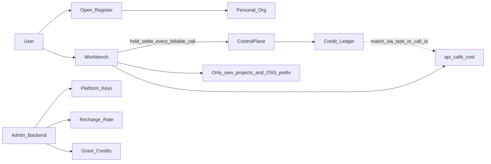

# SaaS 完整计划（P0 / P1 / P2）

与 [DECISIONS.md](DECISIONS.md) 一致。进度见 [STATUS.md](STATUS.md)。

## 架构

- **控制面**：账号、个人组织、积分、平台 Key、汇率、管理充值与对账  
- **工作台**：创作；SaaS 模式下验控制面 JWT、扣积分、注入平台 Key、用户数据隔离  
- **跟上游**：只合并工作台；控制面独立发版  

## P0 — 控制面

| ID | 项 | 状态 |
| --- | --- | --- |
| CP-01 | 仓骨架 + Postgres + Alembic | 已做（迁移未必已打进本机库） |
| CP-02 | 开放注册/登录 + JWT（`user_id`+`org_id`） | 已做 |
| CP-03 | 注册自动个人组织 | 已做 |
| CP-04 | `GET /v1/me` | 已做 |
| CP-05 | 钱包 balance/held，注册为 0 | 已做（注册路径） |
| CP-06 | hold / settle / release | 已做 |
| CP-07 | credit_ledger（含 task/call/成本字段） | 已做 |
| CP-08 | 管理：Key、汇率、grant、流水 | 已做 |
| CP-09 | 充值汇率配置 | 已做 |
| CP-10 | 成本→积分系数 | 配置 API 已做（种子键） |
| CP-11 | 平台 Key 存储与下发 | 已做 |
| CP-12 | 对账视图 | admin ledger 已做 |

## P0 — 工作台薄适配

| ID | 项 | 状态 |
| --- | --- | --- |
| WB-01 | `DEPLOYMENT_MODE` | 已做 |
| WB-02 | 鉴权桥 → 控制面 JWT | 已做 |
| WB-03 | 登录/注册走控制面 | 已做 |
| WB-04 | 计费前 hold | 已做 |
| WB-05 | 终态 settle/release | 已做 |
| WB-06 | metering × 系数 → 积分 | 已做（系数可配） |
| WB-07 | 平台 Key 注入；隐藏 BYOK | 已做 |
| WB-08 | 项目按 org 过滤 | 已做（路径隔离） |
| WB-09 | 路径 + OSS 前缀隔离 B | 已做 |
| WB-10 | 顶栏余额 | 已做 |
| WB-11 | 契约测试 + 自托管回归 | 待做 |
| WB-12 | 上游同步演练 | 已做（fast-forward，无冲突） |

### 必须扣积分的请求

图像 / 视频 / TTS / 文本供应商调用 / Agent 计费轮次 / 其他走平台 Key 或写入用量账本的调用。  
纯本地读写、列表、不调用供应商的预览可不扣。

### 对账

- `api_calls` = 供应商成本真相  
- `credit_ledger` = 用户积分真相  
- 关联：`task_id` / `call_id` / `hold_id`  

## P0 — 验收

1. 开放注册，余额 0，不赠送  
2. 用户只见自己的项目与对象  
3. 无余额则计费生成被拒  
4. 后台按汇率充值后可消耗  
5. 打模型必扣积分；设置页无用户 Key  
6. 积分变动与成本可匹配；失败释放 hold  
7. 非 saas 自托管行为不变  
8. 相对 upstream 补丁集中在预算触点，完成一次 merge 演练  

## P1（后置）

工作室、邮箱验证、用户积分明细页、Agent/MCP 硬化、支付网关、日限额、自动 upstream CI  

## P2（远期）

企业实例、SSO、多 Worker、完整 BI、邀请制、注册赠送  

## 建议排期

1. 注册/个人组织/JWT +（可选）起真实 Postgres  
2. Key/汇率/grant + hold/settle  
3. 工作台鉴权与扣费钩子 + Key 注入  
4. 隔离 B + 对账  
5. 前端与联调 + upstream merge 演练  
